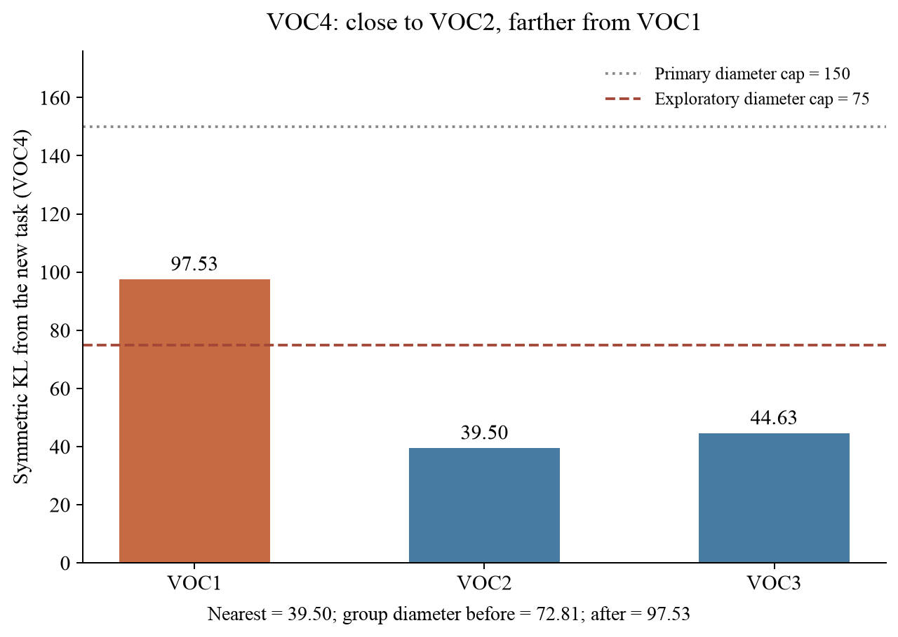

# 组内最大两两 KL 约束：专项测试

本次先检验分组行为，未训练模型、未占用 GPU，也没有测量 AP。使用已有训练图像缓存统计，距离与当前 SVD 预测器一致。主测试 Δ=150；执行前固定探索网格 25、50、75、100、150、200、300，不根据验证集或测试集 AP 选阈值。

## 主测试结果

五任务与十任务中，Δ=150 都不改变原版分组。十任务原版最终为 DIOR、PascalVOC、RUOD 三组，组内最大两两 KL 分别为 41.1091、97.5256、48.0425；都小于 150。

## 十任务探索性对照

原版保留最近邻阈值 150。最近邻对照仅将该阈值设为 min(150, Δ)。跨度方案保留最近邻阈值 150，额外要求入组后整个候选组的最大两两 KL ≤ Δ。

| Δ | 原版组数 | 仅改最近邻阈值 | 增加跨度约束 | 跨度方案与最近邻对照不同的顺序数 |
|---:|---:|---:|---:|---:|
| 25 | 3 | 10 | 10 | 0/6 |
| 50 | 3 | 4 | 4 | 0/6 |
| 75 | 3 | 3 | 4 | 6/6 |
| 100 | 3 | 3 | 3 | 0/6 |
| 150 | 3 | 3 | 3 | 0/6 |
| 200 | 3 | 3 | 3 | 0/6 |
| 300 | 3 | 3 | 3 | 0/6 |

六种顺序只排列数据集块，块内任务顺序固定，并非六个训练种子。各方案在首次分歧后独立更新分组。所有扫描阈值均无恰好等于任务间距离的边界情况。

## 实际触发案例：VOC 第四个任务，Δ=75

| 任务对 | 对称 KL |
|---|---:|
| VOC4 与 VOC1 | 97.5256 |
| VOC4 与 VOC2 | 39.5044 |
| VOC4 与 VOC3 | 44.6307 |

加入前 VOC1、VOC2、VOC3 的组内最大距离为 72.8128，满足 75。VOC4 的最近距离为 39.5044，因此原版阈值 150 和最近邻对照阈值 75 都允许入组；但加入后组内最大距离为 97.5256，超过 75，跨度方案新建一组。三个方案在该任务之前的分组完全一致。

原版与最近邻对照最终均为三个组；跨度方案得到四个组：DIOR 四任务一组、VOC 前三任务一组、VOC 第四任务独立、RUOD 两任务一组。

## 结论与后续训练设计

当前数据未发现超过原版 150 尺度的组内跨度，因此还不能据此声称 DTG 已出现该尺度的漏洞。Δ=75 提供了一个真实且不同于简单调小最近邻阈值的分组干预点，但 75 只是探索网格中的触发值，尚无证据表明它最优或能提升 AP。五任务序列在 75 下仍不改变分组。

下一步若测性能，应使用十任务序列，在 VOC 第四个任务之前保存共同 checkpoint，从同一起点比较原版、最近邻阈值 75、跨度阈值 75，保持其他训练和评估条件一致。先完成前三个 VOC 任务才能取得匹配的共同 checkpoint；已有五阶段权重不能冒充十阶段前缀。正常路由 AP 为主指标，指定组评估用于诊断，并报告旧任务与新任务 AP、组数、参数/存储和耗时。分组分支还会改变初始化、蒸馏和合并过程，性能差异首先解释为策略整体差异。

本次没有启动该性能训练。

数据：`ten_phase/comparison.json`（完整精度、逐任务决策、共同前缀首次分歧）及 `comparison.csv`（六顺序汇总）；`five_phase/` 为五任务对照。
